# Archtype

<p align="center">
  
</p>

<p align="center">
  
  
  <a href="LICENSE">
    
  </a>
  
  
</p>


Archtype is an independent project focused on exploring game engine development using C. The goal is to build a flexible and lightweight foundation for game creation.

The project is currently in its early stages of development.

## Build and Run

Third-party libraries (SDL3, SDL3_image and volk) are downloaded and built automatically by CMake the first time you configure the project, so the first build takes a little longer. They are linked statically: the executables only need a Vulkan driver to run.

### Windows (MSYS2 UCRT64)

1. Install the [Vulkan SDK](https://vulkan.lunarg.com/). Its installer sets the `VULKAN_SDK` environment variable, which CMake uses to find it.
2. Install [MSYS2](https://www.msys2.org/) and, in the **UCRT64** terminal, install the compiler and tools:

   ```
   pacman -S mingw-w64-ucrt-x86_64-gcc mingw-w64-ucrt-x86_64-cmake mingw-w64-ucrt-x86_64-ninja mingw-w64-ucrt-x86_64-lld
   ```

3. Configure, build and run an example:

   ```
   cmake -S . -B build -G Ninja
   cmake --build build
   ./build/bin/triangle_c.exe
   ```

#### Windows (MSVC)

From a **Developer PowerShell for Visual Studio** (with the Vulkan SDK installed):

```
cmake -S . -B build -G "Visual Studio 17 2022"
cmake --build build --config Debug
.\build\bin\Debug\triangle_c.exe
```

### Linux (Ubuntu / Debian)

1. Install the compiler, the tools, the Vulkan development files and the headers SDL3 needs to open windows (X11 and Wayland):

   ```
   sudo apt install build-essential cmake ninja-build pkg-config \
       libvulkan-dev vulkan-validationlayers glslc \
       libx11-dev libxext-dev libxrandr-dev libxcursor-dev libxi-dev libxss-dev libxtst-dev libxfixes-dev \
       libwayland-dev libxkbcommon-dev wayland-protocols libdecor-0-dev
   ```

   You can also use the [Vulkan SDK](https://vulkan.lunarg.com/) from LunarG instead of the distribution's Vulkan packages. On other distributions, install the equivalent packages.

2. Configure, build and run an example:

   ```
   cmake -S . -B build -G Ninja
   cmake --build build
   ./build/bin/triangle_c
   ```

### Build types

Single-config generators (Ninja, Makefiles) build in **Debug** by default. For an optimized build:

```
cmake -S . -B build-release -G Ninja -DCMAKE_BUILD_TYPE=Release
cmake --build build-release
```

### Options

| Option | Default | Description |
|---|---|---|
| `ARCHTYPE_BUILD_EXAMPLES` | `ON` | Build the example programs. |
| `ARCHTYPE_BUILD_TESTS` | `ON` | Build the tests. |
| `BUILD_SHARED_LIBS` | `OFF` | Build Archtype as a shared library instead of a static one. |

Example: `cmake -S . -B build -G Ninja -DARCHTYPE_BUILD_TESTS=OFF`

### Tests

```
ctest --test-dir build
```

### Examples

Executables are placed in `build/bin/`, next to the compiled shaders (`shaders/`) and assets (`textures/`).

| Example | What it shows |
|---|---|
| `hello_c` / `hello_cpp` | Using the engine from C and from C++ (prints the version). |
| `window_c` | Window and main loop, with delta time and FPS in the title. |
| `renderer_c` | Vulkan renderer clearing the screen with a changing color. |
| `triangle_c` | First triangle: shaders and graphics pipeline. |
| `quad_c` | Vertex and index buffers. |
| `paint_c` | Drawing a color-changing trail with the mouse. |
| `spin_c` | 3D quads with a uniform buffer (camera) and push constants (objects). |
| `texture_c` | Textures: a generated checkerboard and an image loaded from a file. |


## Technologies

### Language and API

<<<<<<< HEAD
- **C99** | The engine is implemented in C99. Its public API supports C++ projects through C-compatible headers. An optional C++ example can be enabled with `-DARCHTYPE_BUILD_CPP_EXAMPLE=ON`; it is excluded from the default build. **Lua** support is planned through bindings.
=======
- **C99** | The engine is written in strict C99 (`-std=c99`). Its public headers are wrapped in `extern "C"`, so games can be written in **C** or **C++**. **Lua** support is planned through bindings.
>>>>>>> f6c0c58 (Replace stb_image with SDL3_image and document the build)
- **Vulkan 1.3** | Graphics API. The renderer uses Vulkan 1.3 features: **dynamic rendering** (no render pass or framebuffer objects) and **synchronization2** (simpler barriers and queue submits).

### Build

| Technology | Description |
|---|---|
| **CMake** (3.20+) | Build system. Third-party libraries are downloaded automatically with `FetchContent`. |
| **Ninja** | Recommended build generator. |
| **GCC / MinGW-w64** | Compiler on Windows (MSYS2 UCRT64) and Linux. MSVC is also supported. |
| **LLD** | Linker used with MinGW when available, since GNU `ld` can crash when linking the Vulkan code. |

### Libraries

| Library | Used for | License |
|---|---|---|
| [**Vulkan SDK**](https://vulkan.lunarg.com/) | Vulkan headers, validation layers (debugging) and the `glslc` shader compiler. | Apache 2.0 |
| [**SDL3**](https://www.libsdl.org/) | Window creation, input events, time, the executable's folder, Vulkan loading and surface creation. Built as a static library. | zlib |
| [**SDL3_image**](https://github.com/libsdl-org/SDL_image) | Loading images (PNG, JPG, BMP, TGA, GIF, QOI...) for textures, with its built-in decoders (no libpng or libjpeg). Built as a static library. | zlib |
| [**volk**](https://github.com/zeux/volk) | Loads Vulkan at runtime, so there is no Vulkan library to link against. Device functions are loaded straight from the driver for faster calls. | MIT |

### GPU memory allocator

GPU memory is managed by Archtype's own allocator, written in C99 (`src/renderer/vulkan/vk_allocator.c`), with no third-party code:

- Vulkan limits how many memory allocations can exist at once, so memory is allocated in large blocks and each buffer or image gets a piece of one.
- Buffers and images use separate blocks for each memory type.
- Free space is tracked as a list of ranges: allocating takes the first one that fits, and freeing merges the range with its neighbors.
- Resources bigger than half a block get memory of their own.
- CPU-visible memory is mapped once and stays mapped.

### Shaders

Shaders are written in **GLSL** and compiled to **SPIR-V** at build time with **glslc** (included in the Vulkan SDK). The compiled `.spv` files are placed next to the executables and loaded at runtime.


## 📋 License

Archtype is licensed under the GNU General Public License v3.0 (GPL-3.0).

See the [LICENSE](LICENSE) file for details.