# Archtype

  

  
  
  
  
  

Archtype is an independent project focused on exploring game engine development using C. The goal is to build a flexible and lightweight foundation for game creation.

The project is currently in its early stages of development.

## Build and Run

Build instructions will be added as the engine develops.

## Technologies

### Language and API

- **C11** | The engine is written in C11. Its public headers are wrapped in `extern "C"`, so games can be written in **C** or **C++**. **Lua** support is planned through bindings.
- **Vulkan 1.3** | Graphics API. The renderer uses Vulkan 1.3 features: **dynamic rendering** (no render pass or framebuffer objects) and **synchronization2** (simpler barriers and queue submits).

### Build

| Technology | Description |
|---|---|
| **CMake** (3.20+) | Build system. Third-party libraries are downloaded automatically with `FetchContent`. |
| **Ninja** | Recommended build generator. |
| **GCC / MinGW-w64** | Compiler on Windows (MSYS2 UCRT64) and Linux. MSVC is also supported. |
| **LLD** | Linker used with MinGW when available, since GNU `ld` can crash when linking the Vulkan code. |

### Libraries

| Library | Used for | License |
|---|---|---|
| [**Vulkan SDK**](https://vulkan.lunarg.com/) | Vulkan headers, validation layers (debugging) and the `glslc` shader compiler. | Apache 2.0 |
| [**GLFW**](https://www.glfw.org/) | Window creation, input events and Vulkan surface creation. | zlib |
| [**volk**](https://github.com/zeux/volk) | Loads Vulkan at runtime, so there is no Vulkan library to link against. Device functions are loaded straight from the driver for faster calls. | MIT |
| [**VMA**](https://github.com/GPUOpen-LibrariesAndSDKs/VulkanMemoryAllocator) (Vulkan Memory Allocator) | GPU memory allocation for buffers and images. It groups many resources into few large allocations, avoiding the driver's allocation limit. | MIT |
| [**stb_image**](https://github.com/nothings/stb) | Loading images (PNG, JPG, ...) for textures. | Public domain / MIT |

### Shaders

Shaders are written in **GLSL** and compiled to **SPIR-V** at build time with **glslc** (included in the Vulkan SDK). The compiled `.spv` files are placed next to the executables and loaded at runtime.

## 📋 License

Archtype is licensed under the GNU General Public License v3.0 (GPL-3.0).

See the [LICENSE](LICENSE) file for details.
